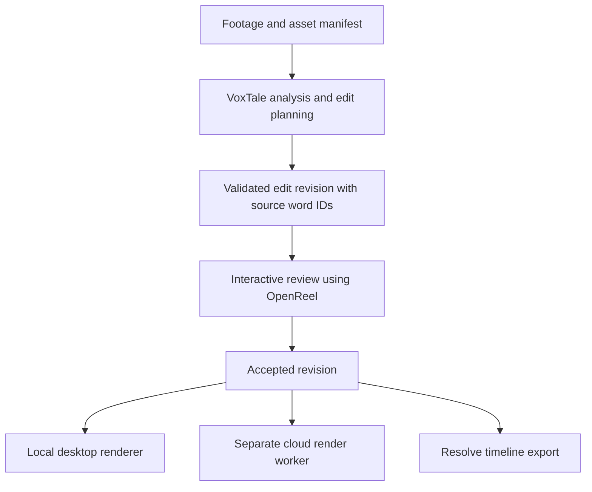

**Agentic video editing: foundations and deployment**

Research date: 29 September 2026. Task: super-tale-3vx6. This is an investigation and proposed direction; no product integration has been built.

**Recommendation: keep VoxTale's edit planning, trial OpenReel for the interactive editor, and give cloud rendering its own worker.** For long raw recordings, a desktop client that signs into VoxTale is a strong target: cloud planning, local media and local export. Keep cloud export as an option. Start a cloud-only pilot with our current renderer on a separate CPU VPS if avoiding an installer matters more.

BlitzRecorder is worth considering for capture and screen-recording workflows. It is a weaker base for a general editor spanning raw footage, B-roll and motion graphics. OpenReel offers much more reusable editing code, but needs a focused integration trial before adoption.

The three choices solve different parts of the job:

| Foundation | What it saves us | Main work left | Best fit |
|---|---|---|---|
| Our `src/video` | Transcript-based take selection; pause trimming; retained-speech checks; edit provenance; a working FFmpeg/Remotion render path | Interactive review; richer timeline; story planning; asset selection; audio polish; product integration | Fastest route to a constrained cloud auto-edit product |
| BlitzRecorder | Native Mac capture; separate synchronized sources; local speech models; silence UI; cursor zoom; native export | Agent tools that change edits; general media workflow; VoxTale auth; licensing choice; other desktop platforms | A Mac recorder with editing assistance |
| OpenReel | React/TS timeline; typed actions and undo; agent tools; motion/effect controls; browser export; Electron shell and native encoding | VoxTale planning/auth; source-media mapping; render integration; round-trip checks; real-footage quality tests | Strongest candidate for a general interactive editor and device rendering |

Evidence is pinned to our working tree at `04eed8b66a6e3aad4ceb6ab61f877c9016c81f92`, BlitzRecorder `f7979dd3a6a30e54dd0056c16bcb4a4479f8ed8c`, and OpenReel `5f3c85e5fc223c86060bf4b12e1b4dec58e9b8a9`. The external repos were cloned into temporary directories. Our repo had unrelated changes before this work.

Our module already does useful editing. [README](../src/video/README.md), [edit model](../src/video/model.ts), [pipeline](../src/video/pipeline.ts), [renderer](../src/video/render.ts), and [composition](../src/video/composition.tsx) show the current limits:

- One main source; scenes can repeat or reorder its ranges.
- AssemblyAI word timings feed take selection. Repeated-take decisions name surviving word ranges. Validation protects selected replacements, unique lead-ins and distant recaps.
- Silence can come from transcript gaps or FFmpeg level detection. These are separate paths, not a proven combined speech detector.
- Captions follow surviving source ranges. Graphics use validated word anchors.
- Static centered punch-ins, timed text entrances/exits, supplied image/video B-roll and looping music already render.
- Structure reordering is representable, but no automatic story-structure pass exists.
- No automatic B-roll retrieval, vocal/visual take scoring, moving subject-aware zoom, general animation curves, audio ducking or noise cleanup.
- Plans support up to 8,000 selected words per call. Long recordings need sectioning and an audit across sections.
- Media paths are local and absolute. A cloud/device product needs portable asset IDs.
- Rendering prepares every scene again, bundles a composition, and renders with two frame workers. There is no reusable scene cache.
- No website or worker integration exists. The current worker image does not explicitly provision the full Chromium dependency set that Remotion documents.

This is a useful editing backend. Its narrow scene model will become a constraint once video, B-roll, graphics and audio need independent timing.

BlitzRecorder's renderer is native Apple code. Its [architecture](https://github.com/blitzreels/blitzrecorder/blob/f7979dd3a6a30e54dd0056c16bcb4a4479f8ed8c/ARCHITECTURE.md) uses AVFoundation, Metal composition and hardware encoding where available. That pipeline cannot run unchanged on a Linux VPS. The portable Swift domain package contains timeline math; it does not contain a portable full renderer.

Its [timeline model](https://github.com/blitzreels/blitzrecorder/blob/f7979dd3a6a30e54dd0056c16bcb4a4479f8ed8c/Sources/BlitzRecorderApp/TimelineEdits.swift) has cuts, text overlays and eased zoom keyframes, including cursor-generated zoom. Its [silence detector](https://github.com/blitzreels/blitzrecorder/blob/f7979dd3a6a30e54dd0056c16bcb4a4479f8ed8c/Sources/BlitzRecorderApp/SilenceDetection.swift) measures audio windows, suggests a threshold and preserves user overrides. Its [local transcription engine](https://github.com/blitzreels/blitzrecorder/blob/f7979dd3a6a30e54dd0056c16bcb4a4479f8ed8c/Sources/BlitzRecorderApp/LocalTranscriptionEngine.swift) integrates FluidAudio and WhisperKit. Those are concrete strengths for device processing.

The agent surface is small. [MCP source](https://github.com/blitzreels/blitzrecorder/blob/f7979dd3a6a30e54dd0056c16bcb4a4479f8ed8c/Sources/BlitzRecorderApp/BlitzRecorderMCPServer.swift) exposes five tools: list projects, read a project, read its transcript, export saved edits, and check export status. It does not expose cut, reorder, overlay or zoom mutations. Supporting an editing agent requires adding those tools and their validation. Windows currently provides capture/playback rather than the full Mac editor; macOS requires 15+. [Project README](https://github.com/blitzreels/blitzrecorder)

OpenReel has a real agent and headless data layer. Its [HeadlessHost](https://github.com/Augani/openreel-video/blob/5f3c85e5fc223c86060bf4b12e1b4dec58e9b8a9/packages/agent/src/headless-host.ts) wraps the action executor and history around an in-memory project. Turns can commit or roll back. The [runner](https://github.com/Augani/openreel-video/blob/5f3c85e5fc223c86060bf4b12e1b4dec58e9b8a9/packages/agent-runner/src/run.ts) can load JSON, run tools, and save a revision without opening an app.

Its [tool registry](https://github.com/Augani/openreel-video/blob/5f3c85e5fc223c86060bf4b12e1b4dec58e9b8a9/packages/agent/src/registry.ts) includes trim/split/ripple operations, clip transforms, keyframes, subtitles, audio controls, motion compositions, effects and export requests. This saves substantial work in controls and execution. A general tool API does not establish good take selection, story order or B-roll judgment. Keep those decisions in our core and apply accepted plans through a bounded set of actions.

**Headless editing does not establish headless rendering.** OpenReel delegates jobs through an injected runner. Its standalone CLI does not configure one. The inspected tree has no `apps/cloud` or former `gpu-job-runner.ts`, despite an older design/status document describing them. Current source takes precedence over that document.

The full [export engine](https://github.com/Augani/openreel-video/blob/5f3c85e5fc223c86060bf4b12e1b4dec58e9b8a9/packages/core/src/export/export-engine.ts) uses browser media/audio/render engines. Desktop [native export](https://github.com/Augani/openreel-video/blob/5f3c85e5fc223c86060bf4b12e1b4dec58e9b8a9/apps/desktop/src/main/sidecar/export-job.ts) encodes raw frames with FFmpeg; the editor still supplies composed frames. A native encoder is not a standalone timeline renderer.

Agent export wiring also differs by surface: [DesktopApp](https://github.com/Augani/openreel-video/blob/5f3c85e5fc223c86060bf4b12e1b4dec58e9b8a9/apps/web/src/desktop/DesktopApp.tsx) installs the [export job runner](https://github.com/Augani/openreel-video/blob/5f3c85e5fc223c86060bf4b12e1b4dec58e9b8a9/apps/web/src/services/agent/export-job-runner.ts). I found no matching installation in the normal web bootstrap. The browser has manual export, but automatic export through the agent needs checking separately.

OpenReel's desktop package is `1.0.0-alpha.17`; its live site offers alpha.15. Treat it as an early editor with useful working parts. The registry is about 32,000 lines and the project store about 4,500, so adopting it also creates a maintenance cost. Consume a pinned fork/workspace package; these are private source packages, not a stable published SDK. Its [project schema](https://github.com/Augani/openreel-video/blob/5f3c85e5fc223c86060bf4b12e1b4dec58e9b8a9/packages/core/src/types/project.ts) includes browser handles/blobs; serialization and relinking must be part of our adapter.

| Requested behavior | Our module | BlitzRecorder | OpenReel |
|---|---|---|---|
| Remove silences | Implemented; needs creator tuning | Implemented with review/overrides | Reusable edit actions; our pause logic can drive them |
| Choose takes | Transcript-based selection and audit | No equivalent semantic selector found | Tools to apply decisions; no equivalent selector verified |
| Shape the story | Manual scene order; planner needed | Recording scenes/layouts; story planner needed | Rich timeline; story planner needed |
| Zoom | Static centered punch-in | Eased, cursor-aware zoom | Animated transforms/keyframes |
| Motion graphics | Three timed text styles | Text and scene composition | Broad motion workspace, shapes, effects and keyframes |
| Select B-roll | Supplied assets only | No general automatic selector verified | Media/timeline tools; automatic relevance selection still needed |
| Add text/captions | Timed graphics and grouped captions | Text and local transcripts; caption workflow needs checking | Text/subtitle actions and styles |
| Agent operates edits | Typed stage plans, no chat editor | MCP reads and exports only | Broad tools, transactions and desktop MCP |
| Linux unattended export | Existing Remotion/FFmpeg boundary; deploy work needed | Apple renderer unsuitable | Full renderer needs a server adaptation |
| Resolve handoff | New exporter needed | No general exporter verified | Small multicam OTIO exporter; general exporter needed |

Licenses affect the choice. OpenReel's [MIT license](https://github.com/Augani/openreel-video/blob/5f3c85e5fc223c86060bf4b12e1b4dec58e9b8a9/LICENSE) permits a proprietary fork with notices. Its dependencies and packaged binaries still carry their own terms. The [desktop distribution guide](https://github.com/Augani/openreel-video/blob/5f3c85e5fc223c86060bf4b12e1b4dec58e9b8a9/apps/desktop/DISTRIBUTION.md) explicitly bundles GPL FFmpeg builds; rebranding must include those notices/source obligations and replace upstream signing/update settings.

BlitzRecorder is AGPL-3.0-only with a separate [commercial source license](https://github.com/blitzreels/blitzrecorder/blob/f7979dd3a6a30e54dd0056c16bcb4a4479f8ed8c/COMMERCIAL-LICENSE.md). Selling an AGPL app is allowed, but distributing a modified covered app brings source obligations; modified network use can also trigger them. Do not assume a closed fork is permitted without a commercial agreement. This does not automatically require opening every separate VoxTale service; the combined-work boundary needs review if we choose that route. [GNU FAQ](https://www.gnu.org/licenses/gpl-faq.en.html)

Our renderer uses Remotion 4.0.522, which has a custom license. Current terms allow free commercial use for eligible individuals/organizations up to three people. The company automation plan lists $0.01/render with a $100/month minimum. Verify the applicable terms when shipping or growing; it is not MIT. [License](https://www.remotion.dev/license), [pricing](https://www.remotion.dev/docs/license/pricing)

All three proposed deployment options are viable at different stages:

| Deployment | Advantage | Cost or constraint | Assessment |
|---|---|---|---|
| Agent + render on current VPS | Smallest initial infrastructure change | Uploads, scratch disk and CPU/RAM compete with web, Convex and other jobs | Dev smoke tests or tightly limited previews |
| Agent on current VPS; render on separate VPS | Unattended export, isolated failures, consistent runtime | Upload time, render queue, storage, compute bill | Best first cloud production route |
| VoxTale desktop app; local render | No full source upload; local encoder; same account and subscriptions | Installer/updates; OS/codec variance; export stops when device sleeps/closes | Strong target for regular long-form creators |
| VoxTale browser editor; local render | Avoids installer; fits OpenReel web | Tab lifetime, browser codecs, memory and file persistence | Useful fourth option for shorter/simpler edits |

The current production VPS was recorded as 4 GB in project deployment notes; I did not inspect its live size or load. Even on a larger host, isolate heavy jobs with container CPU/RAM limits, scratch-disk quotas and concurrency controls. A starting benchmark candidate is 8 vCPU/16 GB RAM with one 1080p job at a time; this is a test configuration, not a proven minimum. Start CPU-only with our renderer. Add a GPU only after measuring a bottleneck it can accelerate; hardware encoding will not speed every decoding, composition or transfer step.

Raw-frame bandwidth explains some local limits. One RGBA 1080p frame is about 8.3 MB; at 30 fps, about 249 MB/s. 4K is about 995 MB/s. OpenReel's native encoder bridge bounds in-flight frames, but still moves that data. Measure sustained throughput and peak memory on actual machines.

Upload time can outweigh export time. As an example, 10 GB over a 20 Mbps uplink takes about 67 minutes before overhead. A device client can send a transcript, audio and selected low-resolution frames for analysis while retaining originals. That is local rendering with cloud analysis, not fully offline/private processing.

Use one VoxTale account across surfaces. The desktop app should sign in through the system browser using Logto authorization code + PKCE, store tokens in the OS credential store, and call scoped VoxTale APIs. Keep provider keys on our server. Enforce account ownership and plan limits there. The client maps content-hashed asset IDs to local files and applies versioned plans. It needs relink checks, progress, cancellation, resume and a clear response to sleep or missing media.

Cloud workers should fetch assets from object storage, stage them locally, render an immutable revision, upload output and report status through Convex. Keep full video bytes out of Convex. Existing jobs already have claims, leases and heartbeats, but claim filtering uses exclusions. A render worker needs an explicit allowed job set/capability route so it cannot consume unrelated jobs.

This shared flow needs a defined supported feature set. Our Remotion composition cannot reproduce all OpenReel effects. Decide which transforms, text styles, transitions and audio operations work in both paths. Validate renderer capability before export; flag richer edits as local-only until the cloud path supports them. Keep one authoritative accepted timeline and preserve unsupported editor fields. Recreating a project from our narrow scene JSON after manual edits would lose work.

The largest missing work is editorial analysis:

- **Takes:** combine words/completeness with audio clipping/noise and selected visual cues. Keep intent and meaningful corrections. Evaluate against human-approved cuts.
- **Structure:** map retained passages to outline beats; propose moves; check references and continuity after reordering. Review major moves.
- **Zoom:** use subject/cursor location and timed curves. Check crop boundaries and faces through the animation.
- **B-roll:** first search supplied assets. Detect shots, index visual summaries, rank by the spoken claim, and check relevance/factual fit. Record source rights and credit requirements. Stock search or media import alone does not solve this.
- **Text/motion:** start with constrained templates, stable IDs and safe text areas. Render sample frames to catch collisions and clipped text.
- **Audio:** add fades at cuts, loudness control and music ducking before treating an edit as ready to publish.
- **Agent execution:** expose a small set of validated tools, batch cuts/placements and render short review sections. Avoid one model call per cut or handing a model every graphics tool by default.

DaVinci export is a practical feature. Start with an editable rough cut. Resolve supports OTIO timeline import/export, including bundles with media. [Blackmagic's OTIO guide](https://documents.blackmagicdesign.com/SupportNotes/DaVinci_Resolve_18.5_New_Features_Guide.pdf?_v=1681801210000) and [18.6.5 release notes](https://forum.blackmagicdesign.com/viewtopic.php?p=1019172&t=196226) document support.

Export source references, cut ranges, track placement, separate speech/music, B-roll and markers. Include an output-timed SRT sidecar, asset manifest and reference MP4. Preserve source handles so users can extend cuts. Support rational frame rates and source timecode; variable-frame-rate normalization needs an explicit mapping back to originals.

OpenReel's [multicam OTIO helper](https://github.com/Augani/openreel-video/blob/5f3c85e5fc223c86060bf4b12e1b4dec58e9b8a9/packages/core/src/multicam/otio.ts) emits video tracks and stores panel layout in custom metadata. It does not export general editor audio, text or effects, and Resolve will not infer our layouts from that metadata. Its one unit test checks panel track counts, not Resolve import.

Do not promise editable motion graphics or exact effect parity through OTIO. Bake complex overlays to media with alpha where supported; native text/transforms need a separately tested adapter. Use FCP XML as a fallback if a tested Resolve target needs it. EDL loses too much for rich edits. [OTIO overview](https://github.com/AcademySoftwareFoundation/OpenTimelineIO/blob/main/README.md)

The existing [Resolve plugin spec](resolve-plugin-spec.md) and open issue `super-tale-bkr` remain future work. File export can ship before a Resolve plugin; it avoids making external scripting a requirement.

Verification completed during this investigation:

| Check | Result | What it establishes |
|---|---|---|
| Our video model/pipeline/stages/transcript tests | 28 pass | Existing plan validation and stage behavior |
| Our opt-in render integration | 1 pass | Real synthetic MP4 with cuts, B-roll, text/captions/music and audio timing |
| OpenReel frozen dependency install | Pass; lifecycle scripts disabled | Lockfile resolves on this Mac |
| OpenReel agent tests | 471 pass | Tool/action/loop behavior under its fixtures |
| OpenReel headless runner tests | 21 pass | Data edits, file round trips, queue and mocked model flow |
| OpenReel selected core tests | 51 pass | Serializer, action executor and multicam OTIO shape |
| OpenReel web and runner typechecks | Pass | Checked packages compile |
| OpenReel runner build + CLI help | Pass | Standalone Node CLI builds and starts |
| BlitzRecorder portable domain tests | 14 pass | Portable timeline/domain math |
| OpenReel live browser inspection | Editor loaded; timeline, AI panel and export menu visible | UI availability only |

No paid model requests ran. I did not export footage through OpenReel, build the full BlitzRecorder app, benchmark a VPS or import a generated timeline into Resolve. Passing unit tests does not establish editorial quality, long-form stability or complete rendering parity.

Before committing to a foundation, run one bounded adoption trial: use the same real 10–20 minute recording, approved cut list, image and video B-roll, captions, timed title and animated zoom. Import our accepted plan into OpenReel; edit manually; save/reopen; export locally; and compare timing with our renderer. Benchmark a separate Linux render host, including peak RAM, scratch disk and retry. Import the rough cut into the chosen Resolve Free/Studio version and verify relinking and sound.

Choose OpenReel if that trial preserves edits and exports reliably with modest adapter work. Use our renderer plus a focused review UI if OpenReel's render/state integration dominates the work. Revisit BlitzRecorder if capture, iPhone camera support or cursor-driven screen edits become a core product requirement.

