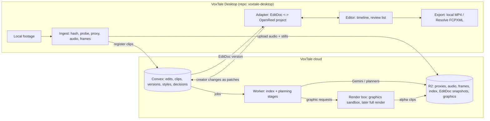

# Agentic video editor — build plan

**Status:** P0–P7 built (see [Build status](#build-status)); v2 open. Written 30 September 2026. Builds on
[agentic-video-editing-research.md](agentic-video-editing-research.md) (foundation
comparison, licenses, deploy options, Resolve handoff) and the current
[`src/video`](../src/video/README.md) module.

## Decisions already made

| Decision | Detail |
|---|---|
| Base app | OpenReel (MIT) as the starting code for VoxTale Desktop, then heavily changed and fully rebranded as our own editor. BlitzRecorder stays an import source only. |
| Repos | Desktop app in its own private repo (`voxtale-desktop`). Planning core, schema, cloud jobs stay here. Shared code flows one way, as a versioned package. |
| Where the agent runs | Cloud. Desktop does files, proxies and render. Prompts, model keys and plan limits stay on our servers. |
| Video understanding | Gemini reads each clip before any edit decision. Transcripts alone are not enough. |
| Motion graphics | Opus 5.5 writes Remotion components. They run and render only in the cloud. |
| Outline input | Optional. An outline session sharpens the plan; without one the agent infers the story from the footage. |
| Agent limits | The agent edits named tracks only, under a per-track policy the creator controls. |
| Personalization | v1 reads every tunable value from one style object. v2 fills that object from the creator's channel and past edits. |
| Evaluation | No eval set now. Log every decision and the creator's response to it, so one can be built later. |
| Path to cloud-only | Same plan format everywhere. Moving render to the cloud later changes where render runs, nothing else. |

## What the creator sees

1. Opens VoxTale Desktop, signs in with their VoxTale account.
2. Drops in clips: A-roll takes, B-roll, screen recordings, music, logos.
3. Optionally picks an outline session and writes a short instruction
   ("8 minutes, keep the demo, fast pace").
4. Chooses what the agent may touch (defaults: everything on).
5. Waits while clips are indexed and the edit is planned. Raw footage stays on
   the machine; audio and small stills go up.
6. Gets a full timeline in the editor, a story map, and a short list of
   decisions the agent was unsure about.
7. Adjusts by hand or asks for a redo of one part ("redo B-roll in the intro",
   "less text"). Manual changes are never overwritten.
8. Exports: MP4 rendered on the machine, or a DaVinci Resolve timeline.

## Architecture



Core stays in `src/video` (pure logic, injected providers, same rule
as the rest of core). The desktop app lives in its own repo (§8). `apps/worker`
gains video job types. No domain logic in `apps/`.

## 1. Edit document v2 (EditDoc)

The current model has one `source` and a flat scene list. It cannot hold
several clips or independent track timing. EditDoc v2 replaces it; the current
stages migrate onto it.

```ts
interface EditDoc {
  version: 2;
  id: string;                      // stable across revisions
  revision: number;
  fps: {num: number; den: number}; // rational: 30000/1001 etc.
  canvas: {width: number; height: number};
  clips: ClipRef[];                // content-hashed; no local paths
  tracks: Track[];                 // fixed kinds, see below
  markers: Marker[];               // chapters, review notes
  mix: MixSettings;                // loudness target, ducking rules
  brief: StoryBrief;               // story map the plan follows
  styleRef: {id: string; revision: number; snapshot: EditStyle};
  policy: TrackPolicy;             // what the agent may change
  provenance: StageStamp[];        // stage, prompt id+version+hash, model, cost
  editorExtras?: unknown;          // OpenReel fields we do not model; preserved
}

interface ClipRef {
  id: string; hash: string;        // sha256 of original bytes
  kind: 'video' | 'audio' | 'image';
  role: 'a-roll' | 'b-roll' | 'screen' | 'music' | 'sfx' | 'voiceover' | 'logo' | 'other';
  roleSource: 'creator' | 'index';
  duration: number; fps?: number; width?: number; height?: number;
  indexRef?: string;               // footage index key, see §2
}

interface Item {                   // common to every track item
  id: string;                      // stable; survives replanning
  start: number; end: number;      // output timeline seconds (frame-snapped)
  owner: 'agent' | 'creator';      // creator items are never modified by the agent
  stage?: string;                  // which stage produced it
  reason?: string;                 // one line, shown in review
  evidence?: Evidence[];           // word ids, shot ids, beat ids
  confidence?: number;             // model estimate; not calibrated
  status: 'applied' | 'suggested';
}
```

Source time lives on clip-backed items (`clipId`, `in`, `out`). Output time is
derived. Captions keep source word IDs so they follow cuts, as today.

### Tracks

Fixed set in v1. Each kind has its own item schema, the stage that writes it and
the checks code runs on it.

| Track | Items | Written by | Checks |
|---|---|---|---|
| `a-roll` | Clip ranges in story order; layout (camera / screen / split) when a take has several sources | Assembly | No gaps unless intended; every kept range has speech or a reason; keep faces in view |
| `zoom` (v3) | Zoom segments on output time: depth, focus, ease in/out, optional pan; a-roll only | Zoom | No overlaps; eases fit inside the zoom; crop never leaves the frame |
| `b-roll` | Video/image cutaways over A-roll; audio muted by default | B-roll | Shot exists and is usable; not reused unless allowed; never covers an A-roll moment marked must-show |
| `captions` | Word groups from kept speech | Text | Only surviving words; reading-speed limit; inside safe area |
| `text` | Titles, lower-thirds, chapter cards, callouts — template based, editable in the editor | Text | Template exists in the style; text fits; no clash with captions or faces |
| `graphics` | Generated motion graphics, baked to alpha video | Graphics | Rendered asset exists; duration matches; passed visual checks (§5) |
| `music` | Music beds from the creator's library | Audio | Ducked under speech; fades at start/end |
| `sfx` | Short effects tied to cuts, text or graphics | Audio | Level below speech; tied to an item that exists |
| `voiceover` | Creator-supplied narration | Assembly | Same checks as A-roll speech |
| markers | Chapters, notes for review | Structure | Chapter titles within YouTube limits; first at 0:00 |

Not tracks, but global settings in `mix` and the style: loudness target, speech
cleanup, transitions at cut points (a property of the cut), colour/LUT (v2).

Adding a track kind later = one schema entry, one stage owner, one adapter
mapping, one renderer mapping. Same pattern as lint `CHECKS`.

### Track policy (the agent's limits)

```ts
type TrackMode = 'off' | 'suggest' | 'auto' | 'locked';
type TrackPolicy = Record<TrackKind, TrackMode>;
```

- `off` — stage skipped, track untouched.
- `suggest` — changes land as `status: 'suggested'`, shown in review, applied
  only when accepted.
- `auto` — changes applied; low-confidence ones still go to review.
- `locked` — agent may read the track, never change it. Tracks the creator has
  hand-edited heavily default to `locked` on replans.

Code enforces the policy when applying a stage's output. A stage that returns
changes for a track it may not touch fails validation; the model never gets
the final say on its own limits.

## 2. Footage index (Gemini)

Built once per clip, keyed by `hash + prompt version`, reused across projects.
This is what lets the agent know what is on screen. Spike 2
([results](agentic-video-editor-spike2.md)) showed Gemini names what is on
screen well but gets times wrong on long video, so **our code owns time and
Gemini only labels spans we cut.**

**On the desktop:**
1. Hash, probe (duration, fps, resolution, audio streams, VFR flag).
2. Audio: mono 16 kHz FLAC (current path).
3. Shot cuts: `ShotDetector` from `@voxtale/editdoc` (TS port of
   `voxtale_native` `video_pacing`), every frame at 96×54 from the bundled
   FFmpeg.
4. Segments: shot cuts, long shots split into ≤20 s chunks, IDs `S001…`.
5. Stills: 512 px JPEG at 30% and 70% of each segment (one under 2 s).
6. Upload audio, segment list and stills to R2. Originals and video proxies
   never leave for indexing.

**In the cloud (`video-index` job):**
1. Transcribe clips that have speech (AssemblyAI, as today; speaker labels on).
2. Gemini Flash reads batches of ~40 segments: each segment's ID, span, spoken
   words and stills. Returns JSON by segment ID:

```ts
interface IndexSegment {
  id: string;                      // ours
  start: number; end: number;      // ours, never the model's
  description: string;             // what is on screen
  subjects: string[]; action: string; setting: string;
  shotType: 'talking-head' | 'screen' | 'wide' | 'medium' | 'close' | 'insert' | 'other';
  onScreenText: string[];
  quality: {blur: boolean; exposure: 'ok' | 'dark' | 'blown'; shaky: boolean};
  usable: boolean;
  mustShow?: string;               // e.g. "demo result appears", "reaction"
}
interface ClipIndex {
  clipHash: string; promptVersion: string;
  summary: string; roleGuess: ClipRef['role'];
  segments: IndexSegment[];
  transcriptRef?: string;
}
```

3. Merge by ID. Unknown IDs dropped; missing IDs retried once, then left as
   `description: ''` with `usable` unknown.
4. Embed each segment's text (description, subjects, on-screen text) for search.
5. Store the index JSON in R2; a row in Convex points to it.

Cost: ~$0.43 per hour of talking head, ~$1.05 per hour of busy screen
recording. Stills and audio go to Google and AssemblyAI — privacy copy says so.

The creator can correct a clip's role or a segment description. Corrections are
stored as overrides and survive re-indexing.

## 3. Story brief

Every plan follows a `StoryBrief`. It uses the outline agent's v2 beat schema
(`outlineBeatSchema` in `src/outline-agent/v2.ts`: role, content,
visual, visualStatus, durationSeconds, claimIds) so an outline and an inferred
brief are interchangeable.

```ts
interface StoryBrief {
  source: 'outline' | 'inferred' | 'outline+inferred';
  outlineRef?: {sessionId: string; version: number};
  instruction?: string;            // creator's free text
  targetDuration?: number;
  beats: BriefBeat[];              // outline beat + matched footage refs
  coverage: CoverageNote[];        // beats with no footage, visuals not found
}
```

- **Outline given:** match A-roll passages to beats, then fill gaps.
- **No outline:** a structure stage reads the A-roll transcripts and the index
  and proposes beats (hook, setup, progress, proof, payoff, ending), marking
  which clip ranges belong to each.
- The brief is shown as a story map. The creator may edit it before assembly;
  by default the pipeline continues without waiting.

## 4. Planning stages

A fixed pipeline, not a free chat agent with every editor tool. Each stage:
one registered prompt (`video.*`), one or two model calls that decide a whole
batch, a code check, at most one repair pass, output written as a patch to the
tracks it owns. Every stage can be re-run alone.

| # | Stage | Reads | Writes | Model |
|---|---|---|---|---|
| 1 | Index | clips | footage index | Gemini + AssemblyAI |
| 2 | Structure | index, transcripts, outline?, instruction | brief, markers | Opus or Sonnet |
| 3 | Assembly | brief, transcripts, index, style.pace | `a-roll`, `voiceover` | Sonnet (current take-selection logic, extended across clips) |
| 4 | Zoom | a-roll, index, cursor data if present | zoom track segments | rules first, model for emphasis points |
| 5 | B-roll | a-roll words, brief visuals, index search | `b-roll` | embeddings shortlist → Sonnet picks |
| 6 | Text | kept words, brief, style | `captions`, `text` | captions by code; titles/callouts by Sonnet |
| 7 | Graphics | brief claims, text track, style | `graphics` | Opus 5.5 (§5) |
| 8 | Audio | music/sfx library, cut points, style | `music`, `sfx`, `mix` | picks by model; ducking and loudness by code |
| 9 | Review | preview renders of each section | review list, repair patches | perceiver (vision) checks |

**Assembly** extends what works today: repeated-take detection with named
replacements, retained-speech audit, protected unique lead-ins and distant
recaps, pause shortening. New: choose between takes across different clips,
place passages in brief order, split long recordings into sections (8,000-word
plan limit) with a check across sections.

**Review** uses the rule we proved on thumbnails: ask about defects, never about
taste. Examples: "does the B-roll match what is being said?", "does text cover
the face?", "is any text cut off?", "is there a jump cut in mid-word?". Major
defects trigger one repair of that item; others go to the review list.

**Revise requests** ("less text in the intro") route to the right stages and
time range, respecting the policy, and produce a new revision. This is the chat
feel without handing the model raw editor tools.

## 5. Motion graphics (Opus 5.5 + Remotion)

Two levels:

- **Templates** on the `text` track: lower-thirds, chapter cards, callouts.
  Fixed components, parameters from the style. Editable in the editor like
  normal text. Cheap and safe. Most text goes here.
- **Generated** on the `graphics` track: stats, diagrams, lists, maps,
  comparisons — anything a template cannot show. Opus 5.5 writes a Remotion
  component.

**Graphic job (`video-graphic`), on the render box:**
1. Input: a request from stage 7 — purpose, content data, anchor words,
   duration, safe area, style tokens.
2. Opus writes a component against our **graphics kit**: a small set of our
   own components and helpers (fonts, colours, easing, layout grid, icons) that
   reads style tokens. It must export a props schema, so later text changes
   re-render without another model call.
3. Checks before running: imports only from `remotion` and the kit; no network,
   file, process or `eval` access (AST check); bundle succeeds.
4. Render still frames at key moments → code checks (text contrast, inside
   safe area) and perceiver defect checks (text cut off, overlap, empty frame,
   wrong data) → one repair if needed. Spike 3
   ([results](agentic-video-editor-spike3.md)): the perceiver judged contrast
   too strictly, so contrast is a code check.
5. Render with alpha: VP9 alpha `.webm` for the desktop app (Chromium can't
   decode ProRes — spike 1) and ProRes 4444 `.mov` only for the Resolve
   hand-off. Store source, props and renders as one graphics asset.

**Safety:** generated code runs only in a locked container on the render box —
`--network none`, read-only root, tmpfs scratch, 2 GB / 2 CPU / 512 pids, all
capabilities dropped, non-root, fresh per job. The AST gate is a first filter;
the container is the wall. Never on a creator's machine. Baked alpha clips also make graphics portable to Resolve.

**Cost:** Opus calls plus Remotion's automation license per render ($0.01,
$100/month minimum at current terms). Track both in `provenance`.

## 6. Style (personalization-ready)

Every tunable value any stage uses comes from one `EditStyle`. No stage keeps
its own constants. This is what makes v2 personalization a data change, not a
rewrite.

```ts
interface EditStyle {
  id: string; revision: number; name: string;
  brand: {
    colors: {primary: string; accent: string; background: string; text: string};
    fonts: {heading: string; body: string};
    logoAssetId?: string;          // existing `brand` asset role
    captionStyle: CaptionStyle;    // size, weight, highlight colour, position
    templates: Record<'lowerThird' | 'chapter' | 'callout', string>;
    graphicsKitVariant: string;
    safeMargins: number;
  };
  pace: {
    targetCutsPerMinute: number;
    maxPauseSeconds: number;
    minShotSeconds: number;
    brollCoverage: number;         // 0..1 of A-roll time
    zoomFrequency: 'none' | 'low' | 'medium' | 'high';
    textDensity: 'minimal' | 'normal' | 'dense';
    captions: 'full' | 'keywords' | 'off';
  };
  audio: {musicLevelDb: number; sfx: 'off' | 'subtle' | 'punchy'; loudnessLufs: number};
  content: {keepFillers: boolean; keepAsides: boolean; keepRecaps: boolean};
}
```

- **v1:** a few presets (calm explainer, fast-paced, podcast, tutorial) plus
  brand colours, fonts and logo from the creator's existing brand assets.
  Each EditDoc stores a snapshot of the style it used.
- **v2:**
  - Pace from the creator's own channel: `styleprofile`'s `PacingSignature`
    already measures `cuts_per_minute`, `avg_shot_seconds`,
    `longest_pause_seconds` and opening/closing pace changes.
  - Pace from reference videos the creator admires (same analysis).
  - Lessons from the creator's own changes: repeated rejections ("always
    removes zooms", "shortens captions") become style updates, the way the
    flywheel turns results into lessons.
  - Per-channel styles for creators with several channels.

## 7. Trust without an eval set

- Every item carries `reason`, `evidence` and `confidence`; the editor shows
  them on hover and in the review list.
- Conservative defaults: unsure cuts are suggested, not applied (keep today's
  0.85 rule).
- Source files never change; every revision is kept; any stage can be undone
  as one step.
- Creator items are never modified by the agent.
- Story map and coverage notes explain the plan in plain words before the
  timeline.
- **Decision log:** every agent item's fate — kept, changed (with diff),
  deleted, suggestion accepted or rejected — is stored per stage and prompt
  version. Cheap now; it becomes the eval set later and feeds v2 style
  learning.

## 8. Desktop app (VoxTale Desktop)

### Repo and ownership

- **Own private repo, `voxtale-desktop`**, started from one tagged OpenReel
  release. Not a GitHub fork: we change it heavily and do not plan upstream
  merges. Keep an `upstream` remote only while early fixes from OpenReel are
  still useful, then drop it.
- **Why not this repo:** the fork is several times this repo's size; Electron
  build, signing, updates and a GPL FFmpeg binary need their own CI; and a
  hard repo line keeps editor code from reaching into core.
- **Our product, our brand:** app name, icons, installer, bundle IDs, update
  feed and about screen are VoxTale. Remove the OpenReel name and logo from
  everything users see. MIT requires only that OpenReel's copyright line and
  license text stay in the source and in a licenses screen, next to the FFmpeg
  GPL notice.
- **Prune early:** remove creation/3D, Aurora ray tracer, image app, motion
  creator extras, mobile GPU-cloud auth. Keep timeline, preview, text,
  subtitles, keyframes, audio automation, native FFmpeg export, and the agent
  action layer (the adapter uses it for batched, undoable changes). Spike 1
  writes the keep/cut list before anything is removed.

### What the desktop app takes from this repo

The planning agent never runs on the device. Running it there would ship our
prompts in the app and put model keys on user machines. The app gets plans
from the VoxTale API. From this repo it takes only a thin, pure slice:

| Need | Source |
|---|---|
| EditDoc, EditStyle, TrackPolicy types and zod validation | `@voxtale/editdoc`, published from this repo |
| Pure helpers used on the device: timeline math, mapping captions to kept words, frame snapping | Same package; pure TS, no I/O, no prompts, no model calls |
| Plans, footage index, revise requests | VoxTale API |
| Shot detection during ingest | `ShotDetector` in the same package: TS port of the Python/OpenCV detector, checked against it on real footage (spike 2). The app ships no Python |

**Package rules:**
- Lives at `packages/editdoc/` in this repo; the planner in
  `src/video` imports it too, so there is one definition.
- Published to GitHub Packages (private) with semver. A breaking schema change
  = major bump + EditDoc `version` bump + migration in core.
- The API rejects plans from a desktop build whose package major differs, with
  an "update the app" message.
- `tests-ts/boundary.test.ts` gains a check: `packages/editdoc` imports only
  `zod`, nothing from `src/supertale` beyond itself.

### Desktop features

- **Sign-in:** system browser, Logto authorization code + PKCE, tokens in the
  OS keychain. Scoped VoxTale API; plan limits enforced on the server.
- **Ingest:** §2 desktop steps, with progress, cancel, resume.
- **Adapter** (in `voxtale-desktop`): EditDoc revision → editor project
  changes, applied as one batch through the action layer. Creator changes flow
  back as EditDoc patches for supported fields; anything we do not model is
  kept in `editorExtras`. The EditDoc in the cloud is the record of truth. This
  two-way mapping is the riskiest part; spike 1 tests it first.
- **Media linking:** clip hash → local path; relink check on open; clear
  errors when a file moved or changed.
- **Export:** local MP4 through the bundled FFmpeg; Resolve package: `.fcpxml`
  from `toFcpxml()` in `@voxtale/editdoc` (file URLs), with `.otio` from
  `toOtio()` as fallback (plain absolute paths; file URLs fail), ProRes 4444
  alpha graphics, SRT captions, reference MP4, and a `VoxTale Import.lua`
  Utility script that imports the FCPXML and falls back to the OTIO. Resolve
  Free blocks outside scripting, so this is a file hand-off, not a live link
  (spike 4). Source start timecode read at ingest and written into both,
  or Resolve won't link camera files.
- **Zooms in Resolve:** FCPXML carries clip transforms, so each a-roll clip
  gets its own slice of the zoom track as Zoom/Position keyframes
  (`zoomKeysBetween` over the clip's span). A zoom across a cut splits into
  two clips' keyframes that meet at the same value. A held zoom is plain
  attributes; a cut-in moves its closing key one frame earlier, since two
  keys can't share a time. Position is percent of frame height, y up. Also
  carried: clip and music levels, music fades. Not carried: ducking, text
  styles (markers), captions (SRT).
- **Later:** import BlitzRecorder take folders (separate screen/camera/mic,
  cursor track → zoom input). Read the files only; no AGPL code.

## 9. Cloud

**Convex tables:** `videoEdits` (per project), `videoClips` (hash, role, R2
keys, index status), `editVersions` (revision metadata; EditDoc JSON in R2),
`editStyles`, `graphicsAssets`, `editDecisions` (the decision log).

**Job types:** `video-index`, `video-plan` (payload names the stage and time
range), `video-graphic`, `video-render`. Planning runs on the existing
worker; graphics and render run on a separate render box that claims only its
own job types (the research doc notes claims currently filter by exclusion —
change to an allow list).

**R2 layout:** `video/<userId>/clips/<hash>/{proxy.mp4,audio.flac,shots.json,index.json,source.<ext>}`,
`video/<userId>/edits/<editId>/rev-<n>.json`, `video/<userId>/graphics/<assetId>/...`.
Worker downloads must stream to disk (today's `downloadToFile` loads whole
objects into memory).

**Entitlements:** new meters in `apps/web/convex/entitlements.ts` — indexed
footage minutes, edit plans, generated graphics, cloud render minutes — so cost stays tied to plan.

## 10. Phases

| Phase | Scope | Done when |
|---|---|---|
| **P0 Spikes** (parallel) | (a) OpenReel fork, prune, load a multi-clip plan, manual edit, save/reopen, local export of a 10–20 min video on Mac + Windows. (b) Gemini index on 3 real recordings: timestamp error, description quality, cost per hour. (c) Opus 5.5 → Remotion graphic in a sandbox → alpha render → plays over video in OpenReel and Resolve. (d) OTIO rough cut imports into Resolve Free with sound and relinked media. | Written results per spike; go/no-go on OpenReel and on Gemini route |
| **P1 Core model** | EditDoc v2, tracks, policy, EditStyle v1 in `packages/editdoc` (published) and `src/video`; current stages moved onto it; tests | Existing real-footage regression (OwnPod) still produces the same cut |
| **P2 Desktop shell** | `voxtale-desktop` repo, pruned and rebranded; sign-in, ingest + upload, index job, adapter one-way (cloud → editor), local export | Martin imports clips, sees index, opens an agent timeline, exports MP4 |
| **P3 First usable edit** | Structure (brief optional), assembly across clips, silences, captions, review list, decision log, adapter two-way | Dogfood on 3 real videos; manual edits survive a replan |
| **P4 Visual layer** | B-roll placement, zoom keyframes, text templates, perceiver review | B-roll picks explained and correctable |
| **P5 Motion graphics** | Graphics kit, `video-graphic` job, render box, sandbox | Generated graphic re-renders from props without a model call |
| **P6 Audio** | Music and sfx from creator libraries, ducking, loudness, fades at cuts | Output meets loudness target |
| **P7 Hand-offs** | Resolve export; cloud-only mode (multipart R2 upload, cloud render) | Same EditDoc renders on desktop and cloud within timing tolerance |
| **v2** | Learned style (channel pacing, reference videos, creator changes), shared B-roll library across projects, eval set from decision log | — |

## Build status

| Phase | State | Where |
|---|---|---|
| P0 Spikes | Done | `docs/agentic-video-editor-spike1..4.md` |
| P1 Core model | Done | `packages/editdoc`, `src/video` |
| P2 Desktop shell | Done | `voxtale-desktop` (branch `voxtale`); media stays on disk, streamed by the main process |
| P3 First usable edit | Done | `story-edit.ts`, review list, two-way sync, replan keeps creator items |
| P4 Visual layer | Done | B-roll with alternatives, zooms, text templates |
| P5 Motion graphics | Done | `video-graphic` job on the render box; new props re-render with no model call |
| P6 Audio | Done | `src/video/audio.ts` (music beds per chapter, effects before graphics and chapters, speech gain); desktop ducks music under speech and sets export loudness (measure, gain, limiter). Beat grid: `src/video/beats.ts` finds a music file's tempo and first beat by code (`ClipRef.beats`; measured at plan time: from the file when it is on the planning machine, else from its first 120s of sound over the frame host `audio` op); `buildCut` then moves joins onto beats through their own silence (0.3s at most) and starts footage, graphics and text on a beat within 0.12s. Music with no steady pulse changes nothing. Music shape: the agent's `set_music` gives the word the music comes in on and the lines it leaves bare (`MusicCues` to `planAudio`); beds split around drops and stay in time. Effects by kind (`sfxKind`: name, else length): ticks on graphics and text, sweeps on chapters and b-roll. Zoom kinds (`zoom.ts`): `set_zooms` spans take `kind` punch (cut in, hold) or push (ease in over the line); `reframeFor` crops in up to 1.3x and slides the speaker to the free side while a left/right panel is up. Delivery (`delivery.ts`): `compare_takes` reads each take's sound through the frame host's `audio` op (8 kHz mono, local or relayed) and reports pace, level, pitch, pitch movement, falling/rising end, longest pause; numbers only, the agent chooses. Screen craft: `show_footage` takes `crop` (a region of the source frame), `speed` 1-16 (silent footage only; source span = shown span x speed) and `pip` (the speaker stays in a corner, `pipBox`); b-roll items carry them, the cloud render and the desktop preview and export draw them. FCPXML and OTIO exports do not carry them yet. Watch-down (`agent/preview.ts`): `watch_cut` gives up to 12 frames of the output timeline, layers stacked as the render stacks them (speaker with zoom, footage with crop and speed, corner speaker, graphics; captions and template text listed, not drawn), built from source frames through the frame host so cloud runs can use it; `finish` sends an unwatched cut back once. The same agent watches; there is no second reviewer run. Levels (`levels.ts`): at `finish` code measures the speech level of each kept segment (frame host `audio`, pauses gated out) and sets a-roll `gainDb` toward the median, 6 dB at most, differences under 1 dB left; a host that cannot read sound changes nothing. Voice track (`packages/frames/src/voice.ts`, `src/video/voice.ts`): the frame host `voice` op gives level and pitch per 20 ms for a whole clip, 2 bytes a step, measured where the file is, so no sound leaves the computer for it. From it code marks stressed words in `get_transcript` (`*word*`), lists lines said more than once as takes with delivery (found from the words; delivery added when sound is known), snaps each cut to where the word is heard (`wordEdge`: speech starts a median 0.08s before the transcript's word start), and reports `sound at joins` in the cut report (clipped word, room noise step, voice level step, pitch jump mid-sentence). A host without `voice` gives the editor words alone. Screen read (`src/video/screen.ts`, `agent/footage.ts`): `show_footage` crops a screen recording to the page inside the window bars (per shot, from long unbroken edges that hold still; `crop:"full"` opts out); `screen_activity` lists each change of a synced clip under kept speech with its cut second and word; `find_footage` ranks matches and, with `said`, reads the synced clip at those words. Not built: colour match between clips, an end-screen hold; room tone is not needed while every segment carries its own room sound and the cut has no gaps |
| P7 Hand-offs | Done | Resolve: OTIO export (`packages/editdoc/src/otio.ts`) plus the desktop's Resolve hand-off. Cloud: full clips go up by resumable multipart from the desktop's main process; `video-render` job on the render box (`src/video/render-edit.ts`); API in [agentic-video-editor-api.md](agentic-video-editor-api.md#cloud-render). Desktop and cloud read the same `@voxtale/editdoc` render helpers. Parity on a 34 s test cut: same frame count, 0 ms audio offset at every cut, −14.2 LUFS both, SSIM median 0.96 (`supertale video parity`) |

Style: the creator picks a preset (`calm-explainer`, `fast-paced`, `podcast`,
`tutorial`) for a first cut or a new cut; it sets pace, captions, music level
and effects.

## Risks and open questions

- **OpenReel upkeep.** Large, young, one maintainer. We own the fork after
  P0; no upstream merges planned. If the spike shows the adapter or export
  eating most of the effort, fall back to our renderer plus a focused review
  UI (research doc's alternative).
- **Two-way timeline sync** can lose manual work if wrong. Stable item IDs,
  `owner`, `editorExtras` and the P0 round-trip test exist for this.
- **Gemini timestamps** are wrong on long video (spike 2). Settled: our
  segments own time; Gemini only labels them.
- **Alpha video playback** in the preview: verified after adding `alpha: true` to every `CanvasSink` (spike 3).
- **Resolve hand-off** verified on Resolve Free 21 (spike 4): cuts, tracks,
  markers, audio, linked media and alpha graphics exact. Zooms, text styles,
  audio levels do not travel in OTIO; the FCPXML export (super-tale-ue1k)
  carries zooms and levels — its units and ease need a check in Resolve.
- **Cost per edit** (Gemini + planners + Opus + Remotion) is unknown until
  P0; price the meters after that.
- **Music and sfx rights.** v1 uses only the creator's own files or a licensed
  pack we bundle; no generated music.
- **Privacy.** Stills and audio go to Google and AssemblyAI via our pipeline;
  originals do not. Needs clear copy and a delete path.
